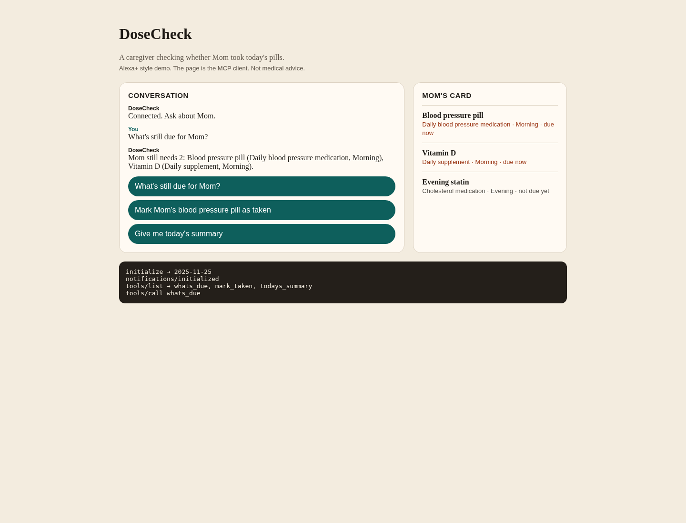

# 💊 DoseCheck

**A voice-style caregiver check-in for a parent's daily pills, built on the Model Context Protocol.**

> 🏆 **Built for the Amazon Developer Hackathon 2026 (Alexa+ track).**
> This is a hackathon demo. **It is not a medical device and gives no medical advice.**

---

## 📸 Screenshot



*The conversation on the left, Mom's live pill card on the right, and the raw MCP protocol log at the bottom.*

---

## 💡 The idea

Millions of people look after a parent who lives somewhere else. The daily question is always the same: *"Did Mom take her pills today?"*

DoseCheck turns that into a simple conversation, the way you would ask Alexa+. The caregiver asks what is due, marks a pill as taken, and hears a short summary. Behind the scenes, every answer comes from real **MCP tool calls**, so any MCP-capable assistant (such as Alexa+) can plug into the same server.

## ✨ What you can do

- 🔔 **See what's due.** Ask which of Mom's pills are due now.
- ✅ **Mark a pill as taken.** For example, the morning blood pressure pill. Aliases work too ("BP", "lisinopril", "vitamin D").
- 🗣️ **Hear today's summary.** Taken, due now, and not due yet.
- 🧾 **Live pill card.** The side panel updates after every call.
- 🔍 **Transparent protocol log.** Watch `initialize`, `tools/list` and `tools/call` happen in real time.

The demo starts with two morning pills due and the evening statin not due yet.

## 🧠 How it works

```
┌────────────────────┐   Streamable HTTP (JSON-RPC)   ┌──────────────────────┐
│  web/index.html    │ ─────────────────────────────▶ │  server.py           │
│  (the MCP client)  │ ◀───────────────────────────── │  MCP server (/mcp)   │
│  Alexa+ style chat │      protocol 2025-11-25       │  + serves the page   │
└────────────────────┘                                └──────────┬───────────┘
                                                                 │ read / write
                                                                 ▼
                                                       data/mom.json
```

The web page is itself an MCP client. It performs the full handshake (`initialize`, then `notifications/initialized`, then `tools/list`) and then calls tools. There is no framework and no build step.

### MCP tools

| Tool | Arguments | What it does |
| --- | --- | --- |
| `list_people` | none | Lists the people the caregiver can check |
| `whats_due` | `person` | Lists pills that are due now and not yet taken |
| `mark_taken` | `person`, `medication` | Marks one pill as taken (refuses if it is not due yet or already taken) |
| `todays_summary` | `person` | Summarizes what was taken and what is still due |

Each reply contains a short spoken sentence plus a compact card block that the page renders as Mom's pill card.

## 🚀 Quick start

**Requirements:** Python 3.11 or newer. No API keys.

```bash
# 1. Clone
git clone https://github.com/itznisila/dosecheck.git
cd dosecheck

# 2. Create a virtual environment
python -m venv .venv
source .venv/bin/activate        # Windows: .venv\Scripts\activate

# 3. Install dependencies
pip install -r requirements.txt

# 4. Start the server
python server.py
```

Then open **http://127.0.0.1:8000** in your browser and click through the three prompts.

### Test the server from the command line

With the server running, in a second terminal:

```bash
python check.py
```

This connects with the official MCP client, prints the tool names, and calls `whats_due` for Mom.

### Reset the demo

Marking a pill as taken is saved to `data/mom.json`. To start over, restore the sample:

```bash
cp data/mom.sample.json data/mom.json      # Windows: copy data\mom.sample.json data\mom.json
```

## 📁 Project structure

```
dosecheck/
├── server.py              # MCP server, tools, and page route
├── check.py               # Small MCP client for testing the server
├── web/
│   └── index.html         # Alexa+ style chat page (MCP client)
├── data/
│   ├── mom.json           # Live state (changes as pills are marked)
│   └── mom.sample.json    # Clean starting state
├── docs/
│   └── screenshot.png     # README screenshot
├── requirements.txt
└── LICENSE.txt
```

## 🛠️ Built with

- **Python 3.11+**
- **MCP Python SDK** (`mcp[cli]==2.3.0`), Streamable HTTP transport
- **Starlette** for the page route
- Plain **HTML, CSS and JavaScript** for the client, with no dependencies

## 🔭 What's next

- Support for more than one person and custom medication schedules
- Real time-of-day logic for when a pill becomes due
- Alerts when a pill is missed
- Connecting the server to a live Alexa+ skill so caregivers can simply speak

## ⚠️ Disclaimer

DoseCheck is a hackathon prototype using sample data only. It is **not** a medical device, does not give medical advice, and must not be used to manage real medication. Always follow instructions from a doctor or pharmacist.

## 📄 License

Released under the [MIT License](LICENSE.txt). © 2026 Nisila Dinod.

## 👤 Author

**Nisila Dinod** · [@itznisila](https://github.com/itznisila)
